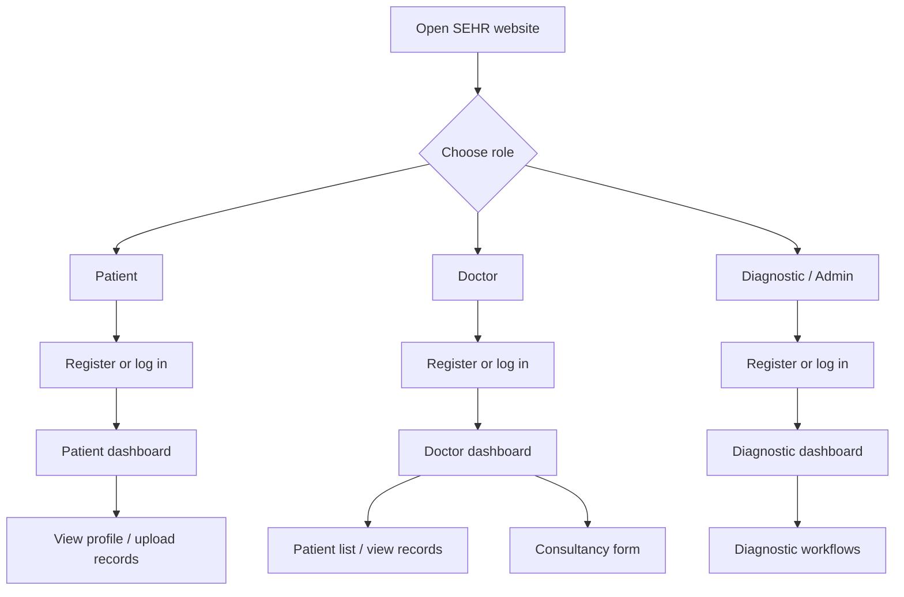
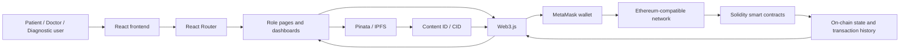
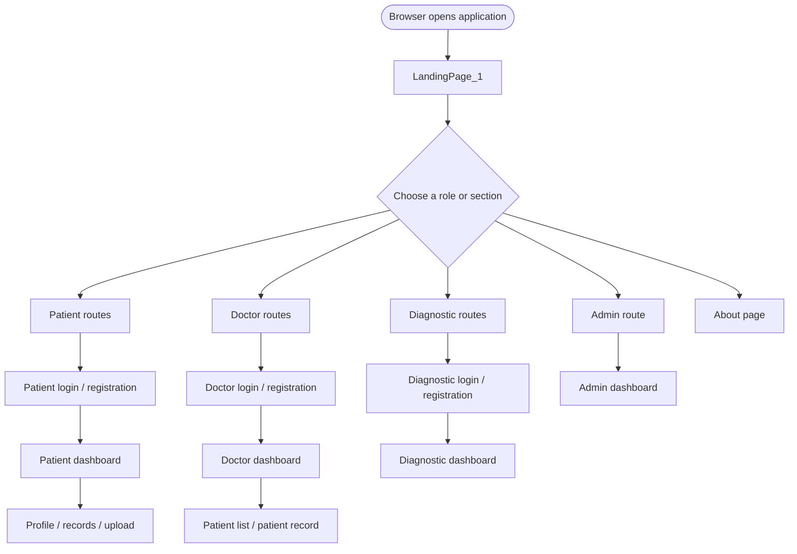
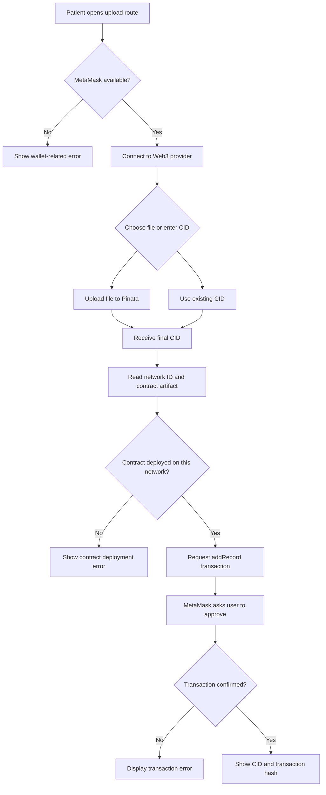
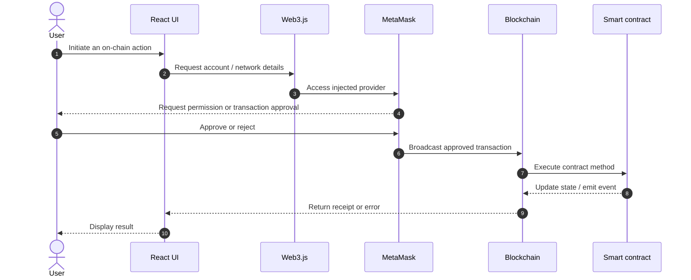
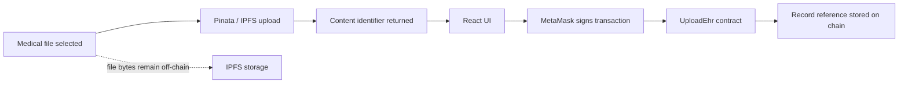
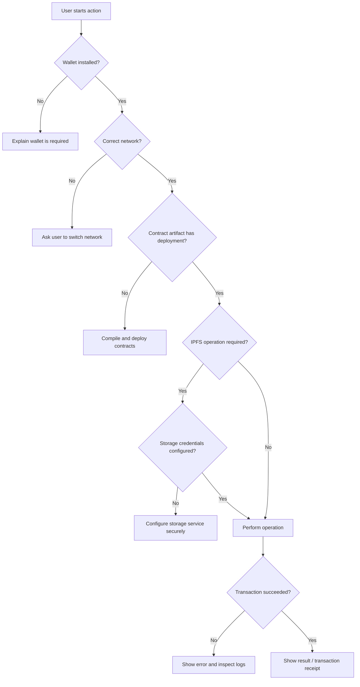
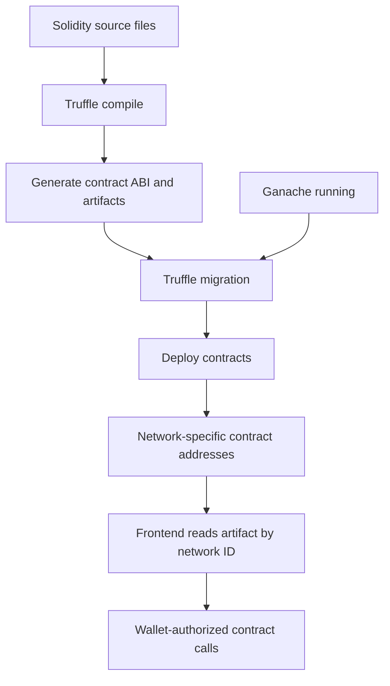
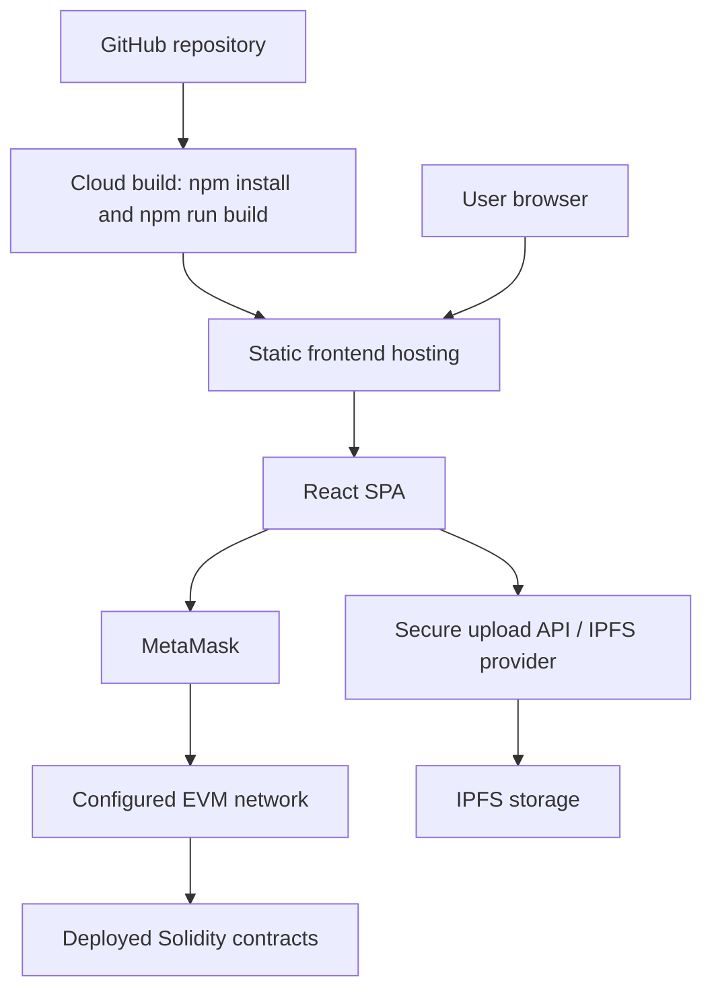

# SEHR — Secure Electronic Health Records on Blockchain

<p align="center">
  <strong>A decentralized Electronic Health Record (EHR) application using React, Ethereum smart contracts, MetaMask, and IPFS.</strong>
</p>

<p align="center">
  <a href="https://ehr.pages.dev">🌐 Live Demo</a> ·
  <a href="https://github.com/TheZohaibKhan/EHR">📦 Source Repository</a> ·
  <a href="docs/DEPLOYMENT_DIAGRAM.md">Deployment Diagram</a> ·
  <a href="docs/SEQUENCE_DIAGRAM.md">Upload Sequence Diagram</a>
</p>

> **Live demo note:** `https://ehr.pages.dev` is the intended demo address from the project deployment plan. If it has not been deployed or configured yet, publish the app first and replace this URL with the real deployed URL. A live page alone does not guarantee that wallet, smart-contract, or IPFS operations are connected.

---

## Table of Contents

- [1. Project Overview](#1-project-overview)
- [2. Problem Statement](#2-problem-statement)
- [3. Project Objectives](#3-project-objectives)
- [4. Key Features](#4-key-features)
- [5. User Roles](#5-user-roles)
- [6. Technology Stack](#6-technology-stack)
- [7. System Architecture](#7-system-architecture)
- [8. Application Flowcharts](#8-application-flowcharts)
- [9. Medical Record Upload Workflow](#9-medical-record-upload-workflow)
- [10. Smart Contracts](#10-smart-contracts)
- [11. Repository Structure](#11-repository-structure)
- [12. Requirements and Prerequisites](#12-requirements-and-prerequisites)
- [13. Installation and Local Setup](#13-installation-and-local-setup)
- [14. Configure Ganache and MetaMask](#14-configure-ganache-and-metamask)
- [15. Compile and Deploy Smart Contracts](#15-compile-and-deploy-smart-contracts)
- [16. Run the React Application](#16-run-the-react-application)
- [17. Using the Application](#17-using-the-application)
- [18. Configuration and Secrets](#18-configuration-and-secrets)
- [19. Testing and Validation](#19-testing-and-validation)
- [20. Deployment Options](#20-deployment-options)
- [21. Deploy the Frontend to Cloudflare Pages](#21-deploy-the-frontend-to-cloudflare-pages)
- [22. GitHub Pages Considerations](#22-github-pages-considerations)
- [23. Troubleshooting](#23-troubleshooting)
- [24. Security and Privacy Notes](#24-security-and-privacy-notes)
- [25. Limitations](#25-limitations)
- [26. Future Enhancements](#26-future-enhancements)
- [27. Contributing](#27-contributing)
- [28. License](#28-license)
- [29. References](#29-references)

---

## 1. Project Overview

SEHR is a decentralized Electronic Health Record application intended to make health-record references easier to manage and verify. The frontend is built with React. The project uses Ethereum-compatible smart contracts for registration and record-reference operations, MetaMask for wallet access and transaction signing, and IPFS/Pinata for off-chain medical-file storage.

Medical files are too large and sensitive to place directly on a public blockchain. In the documented upload design, the file is uploaded to IPFS and the returned content identifier (CID/hash) is used by the application when interacting with a smart contract. The blockchain is therefore used as a transaction and reference layer, rather than as a storage location for the full file.

The repository includes UI components for patient, doctor, and diagnostic/admin workflows, Solidity contracts, Truffle configuration, diagrams, and a React landing page.

### Live Demo

**[Open SEHR Live Demo](https://ehr.pages.dev)**

The URL is a deployment target, not proof that every feature is online. Full functionality depends on the correct frontend build, contract deployment, network configuration, MetaMask, and IPFS credentials/service availability.

---

## 2. Problem Statement

Traditional health-record workflows can involve disconnected systems, duplicated documents, limited interoperability, and uncertainty about who changed or uploaded a record. A centralized application can also create a single point of failure and requires users to trust the system operator.

This project explores a decentralized design in which:

- A web application provides role-specific workflows.
- A wallet is used to authorize blockchain transactions.
- Smart contracts manage selected registration and record-reference operations.
- Medical files are stored off-chain through IPFS/Pinata.
- Content identifiers and transaction receipts can provide traceable references.

This is an academic/demo project and should not be used to store real patient data without a professional security, privacy, regulatory, and clinical review.

## 3. Project Objectives

1. Build a user-facing React application for patient, doctor, and diagnostic roles.
2. Demonstrate wallet connection and transaction signing with MetaMask.
3. Use Solidity smart contracts for registration and electronic-health-record references.
4. Store files off-chain and use IPFS content identifiers rather than storing entire files on-chain.
5. Provide patient-record and profile workflows through React Router.
6. Document the system architecture, data flow, local setup, and deployment process.
7. Create a project README that can be used for demonstrations, evaluation, and further development.

---

## 4. Key Features

The repository contains components and routes for the following areas. The availability of a feature in the code does not imply that it will work before its contract network and external-service configuration are completed.

| Area | Repository evidence / purpose |
|---|---|
| Landing page | `src/components/LandingPage_1.js`, registered at `/` |
| Patient registration and login | Patient registration and login components |
| Doctor registration and login | Doctor registration and login components |
| Diagnostic registration and login | Diagnostic registration and login components |
| Patient dashboard | `src/components/PatientDashBoard.js` |
| Doctor dashboard | `src/components/DoctorDashBoard.js` |
| Diagnostic dashboard | `src/components/DiagnosticDashBoard.js` |
| Admin dashboard | `src/components/AdminDashboard.js` |
| Medical record upload | `src/components/PatientUpload.js` |
| Record viewing | `src/components/ViewPatientRecords.js`, `src/components/DoctorViewRecords.js` |
| Profile pages | Patient, doctor, and diagnostic profile components |
| Wallet / blockchain access | Web3 and MetaMask integrations in React components |
| IPFS upload | `src/utils/pinataClient.js` and `PatientUpload.js` |
| Smart contracts | Solidity contracts under `src/contracts/` and `contracts/` |
| 3D background | `src/components/Background3D.js` using React Three Fiber and Three.js |
| Architecture diagrams | `docs/DEPLOYMENT_DIAGRAM.md`, `docs/SEQUENCE_DIAGRAM.md` |

---

## 5. User Roles

### 5.1 Patient

The patient-facing flow includes registration, login, dashboard access, profile viewing, and a medical-record upload route. The upload component supports choosing a file for IPFS upload or entering an existing IPFS hash.

### 5.2 Doctor

The doctor-facing flow includes registration, login, dashboard access, patient-list/profile navigation, record viewing, and a doctor-form route for consultancy/prescription workflows.

### 5.3 Diagnostic / Admin

The project includes diagnostic registration/login and dashboard components, as well as an admin dashboard route. These pages are intended for diagnostic or administrative workflows. Their final permissions depend on the implemented component and smart-contract checks.

### Role overview



---

## 6. Technology Stack

| Technology | Role |
|---|---|
| React 18 | Frontend UI and component-based application |
| React Scripts / Create React App | Development server and production build |
| React Router DOM 6 | Client-side routes |
| Tailwind-style utility classes and CSS files | UI styling |
| Three.js | 3D rendering |
| React Three Fiber | React renderer for Three.js |
| `@react-three/drei` | Three.js helpers, including stars and line primitives |
| Web3.js | Ethereum-compatible provider and smart-contract interaction |
| MetaMask | Wallet access and transaction approval |
| Solidity | Smart-contract language |
| Truffle | Contract compilation, migration, and testing workflow |
| Ganache | Local Ethereum-compatible development chain |
| IPFS / Pinata | Off-chain storage for files and content identifiers |
| Axios | HTTP requests where used |
| Leaflet / React Leaflet | Map-related UI dependencies where used |
| Font Awesome | Icons |
| Jest / React Testing Library | Frontend testing dependencies |

Versions and dependencies should be taken from `package.json` and `package-lock.json`; this table describes the technologies visible in the repository rather than guaranteeing that every dependency is used by every page.

---

## 7. System Architecture

The application can be understood as four cooperating layers.

1. **Presentation layer:** React pages and reusable components render the landing page, role pages, dashboards, forms, and record views.
2. **Wallet and interaction layer:** Web3 connects the browser to the injected wallet provider. MetaMask prompts the user to approve supported transactions.
3. **File-storage layer:** IPFS/Pinata stores the uploaded file off-chain and returns a CID/hash.
4. **Blockchain layer:** Solidity contracts process supported registration or record-reference operations and maintain blockchain state.

### High-level architecture diagram



### Deployment diagram

The repository includes a dedicated deployment diagram at [`docs/DEPLOYMENT_DIAGRAM.md`](docs/DEPLOYMENT_DIAGRAM.md). It describes the browser, React app, wallet, IPFS/Pinata, Ethereum node, smart contracts, and ledger.

### Architecture considerations

- The React application is a browser client, not a private server.
- A smart contract must be deployed to the network the wallet is connected to.
- The contract artifact must contain a deployment entry for the active network ID.
- IPFS/Pinata credentials must be configured safely; secrets should not be committed to GitHub or exposed in public browser bundles.
- Storing a CID on-chain does not automatically encrypt the file or make the file private.

---

## 8. Application Flowcharts

### 8.1 Main application navigation

The route definitions are in `src/BrowseRouter.js`. The `/` route uses `LandingPage_1`.



### 8.2 Patient record upload



### 8.3 Wallet and smart-contract interaction



### 8.4 Off-chain file storage versus on-chain reference



### 8.5 Error handling overview



---

## 9. Medical Record Upload Workflow

The upload component in `src/components/PatientUpload.js` follows this general flow:

1. The patient selects a file or enters an existing IPFS hash.
2. The frontend checks for the injected Ethereum provider.
3. Web3 reads the current accounts and network ID.
4. When a file is selected, `uploadFileToPinata` is called from `src/utils/pinataClient.js`.
5. The returned CID is passed to the contract call.
6. The frontend calls `addRecord(timestamp, finalHash)` on the `UploadEhr` contract.
7. MetaMask asks the user to approve the transaction.
8. On success, the UI displays the CID and transaction hash.

### Sequence diagram

The repository includes [`docs/SEQUENCE_DIAGRAM.md`](docs/SEQUENCE_DIAGRAM.md) with the upload sequence and a step-by-step explanation.

### Important implementation detail

The source code imports the contract artifact from `src/build/contracts/UploadEhr.json`. That artifact must exist and contain a deployment entry for the current network. Running Truffle migrations is part of the setup process. A missing artifact or missing network entry can cause the application to report that the contract is not deployed.

---

## 10. Smart Contracts

The repository includes these Solidity contract files:

| Contract file | Intended area |
|---|---|
| `PatientRegistration.sol` | Patient registration and patient-related data |
| `DoctorRegistration.sol` | Doctor registration |
| `DiagnosticRegistration.sol` | Diagnostic registration |
| `UploadEhr.sol` | Medical-record reference upload and retrieval |

Contract functionality, access controls, and function signatures should be verified directly in the Solidity source before deployment. Do not assume that a contract enforces a permission rule unless the implementation actually checks it.

### Smart-contract lifecycle



### Contract development commands

Run commands from the directory that contains the appropriate Truffle configuration and contract sources. In this repository, the project includes Truffle-related files in more than one location; follow the actual `truffle-config.js` and contract path for the intended workflow.

Typical commands are:

```bash
npx truffle compile
npx truffle migrate --reset
```

For local development, start Ganache before running migrations. If the application uses generated artifacts in `src/build/contracts`, confirm that the Truffle configuration writes to that path.

---

## 11. Repository Structure

The main files and directories include:

```text
TheZohaibKhan-EHR-19c649c/
├── README.md
├── PROJECT_RUN_INSTRUCTIONS.md
├── package.json
├── package-lock.json
├── public/
│   ├── index.html
│   ├── favicon.ico
│   └── manifest.json
├── src/
│   ├── App.js
│   ├── BrowseRouter.js
│   ├── App.css
│   ├── components/
│   │   ├── LandingPage_1.js
│   │   ├── Background3D.js
│   │   ├── PatientDashBoard.js
│   │   ├── DoctorDashBoard.js
│   │   ├── DiagnosticDashBoard.js
│   │   ├── AdminDashboard.js
│   │   ├── PatientUpload.js
│   │   ├── ViewPatientRecords.js
│   │   ├── DoctorViewRecords.js
│   │   └── ...other role, login, registration, and profile components
│   ├── CSS/
│   ├── big_css/
│   ├── contracts/
│   ├── migrations/
│   ├── test/
│   └── utils/
│       └── pinataClient.js
├── contracts/
│   ├── PatientRegistration.sol
│   ├── DoctorRegistration.sol
│   ├── DiagnosticRegistration.sol
│   └── UploadEhr.sol
├── docs/
│   ├── DEPLOYMENT_DIAGRAM.md
│   └── SEQUENCE_DIAGRAM.md
├── Results/
└── truffle-config.js
```

**Existing website entry points:** `public/index.html` is the standard Create React App HTML shell. The actual homepage UI is implemented in `src/components/LandingPage_1.js`, and `src/BrowseRouter.js` maps `/` to that component. Therefore, this project already has a main webpage; this README update does **not** add a duplicate standalone `index.html` website.

---

## 12. Requirements and Prerequisites

Install the following before running the project locally:

- Node.js and npm
- Git
- MetaMask browser extension
- Ganache for local blockchain development
- Truffle CLI (can be run through `npx`)
- A Pinata/IPFS account and appropriate API configuration if file uploads are to be tested

Check Node.js and npm:

```bash
node --version
npm --version
```

Confirm the installed tools before proceeding. Dependency versions and contract tooling can change, so use the repository's lockfile and Truffle configuration as the source of truth.

---

## 13. Installation and Local Setup

### Step 1 — Clone the repository

```bash
git clone https://github.com/TheZohaibKhan/EHR.git
cd EHR
```

If you are using a ZIP download instead of Git, extract the project and open a terminal in the folder containing `package.json`.

### Step 2 — Install frontend dependencies

```bash
npm install
```

This installs the packages defined in `package.json`.

### Step 3 — Start Ganache

Open Ganache and create or start a local workspace. The repository's Truffle configuration uses a development endpoint at `127.0.0.1:7545` with network ID `*`.

Confirm the actual RPC URL and chain ID shown by your Ganache workspace. These values must agree with the network configured in MetaMask.

### Step 4 — Compile and migrate contracts

Inspect the intended Truffle configuration and contract location, then run the appropriate commands. For the setup described in `PROJECT_RUN_INSTRUCTIONS.md`, the contract workflow is run from the `src` directory:

```bash
cd src
npx truffle compile
npx truffle migrate --reset
cd ..
```

If Truffle reports that it cannot find the configuration or contracts, check whether the current folder contains `truffle-config.js` and whether its `contracts_directory`, `migrations_directory`, and `contracts_build_directory` paths match the actual repository structure. This repository has Truffle-related files in both the root and `src`, so do not run migrations from an arbitrary directory.

### Step 5 — Start React

From the directory containing the root `package.json`:

```bash
npm start
```

The Create React App development server normally opens:

```text
http://localhost:3000
```

### Step 6 — Check the app

- Open the landing page.
- Navigate to patient, doctor, and diagnostic login/registration routes.
- Connect MetaMask when a blockchain operation requires it.
- Test with non-sensitive sample files only.
- Review the browser console and terminal if a route or contract interaction fails.

---

## 14. Configure Ganache and MetaMask

### Ganache

The included Truffle configuration shows a development host of `127.0.0.1` and port `7545`. Your Ganache workspace may show a specific chain ID; use the value shown by the running workspace.

### MetaMask

1. Install MetaMask from its official website.
2. Add a local network using the RPC URL and chain ID displayed by Ganache.
3. Import a **test account** from Ganache only if required for local testing.
4. Connect the account to the application.
5. Confirm the wallet is on the same network where the contracts were deployed.

Never use a real wallet's recovery phrase or private key in source code, README files, screenshots, or public repositories. Do not import a funded mainnet account into a development project.

### Common network mismatch

A contract artifact can contain an address for one network ID but not another. If the frontend reports that a contract is not deployed, verify:

- Ganache is running.
- Migrations completed successfully.
- MetaMask is connected to the same chain.
- The generated artifact includes a deployment under the current network ID.
- The frontend imports the artifact generated by the migration you ran.

---

## 15. Compile and Deploy Smart Contracts

The smart-contract source and migrations should be treated as a separate deployment layer from the React frontend.

### Recommended local sequence

```bash
# Start Ganache first.
# Then, from the directory containing the correct Truffle config:
npx truffle compile
npx truffle migrate --reset
```

### What these commands do

- `truffle compile` compiles Solidity sources and generates contract artifacts.
- `truffle migrate --reset` runs migration scripts and redeploys contracts to the selected development network.
- The generated artifact contains the ABI and network-specific deployment address used by Web3.js.

### After a new deployment

If the contract address changes, make sure the frontend uses the latest generated artifacts. Do not manually guess contract addresses.

For public testnets or production chains, review gas fees, network settings, contract security, ownership, and access controls before deploying. Never use a real patient dataset on a public chain during a demonstration.

---

## 16. Run the React Application

From the project root:

```bash
npm start
```

Available scripts in `package.json` include:

```bash
npm start
npm test
npm run build
```

### Production build

```bash
npm run build
```

Create React App generates a production build in the `build/` directory by default. The output folder is static frontend content; it does not include a running Ganache node, a deployed smart-contract network, or a private IPFS service.

### Build validation

Before deployment, confirm that:

- The build completes without errors.
- The correct homepage component is routed at `/`.
- Assets load with the intended base path.
- React Router deep links work on the selected hosting platform.
- The wallet and contract network are available.
- No secret values are embedded in the public JavaScript bundle.

---

## 17. Using the Application

The following is a suggested demonstration sequence. Exact form fields and permissions should be verified against the actual UI and contract source.

### Patient demonstration

1. Open the landing page.
2. Choose the patient login or registration action.
3. Complete the form using test data.
4. Open the patient dashboard.
5. Open the profile or record-related route.
6. For upload testing, choose a non-sensitive sample file or provide an existing test CID.
7. Approve the transaction in MetaMask when prompted.
8. Save the displayed CID and transaction hash for debugging or demonstration purposes.

### Doctor demonstration

1. Choose doctor login or registration.
2. Open the doctor dashboard.
3. Explore the patient-list route and profile navigation.
4. Test record viewing only with test accounts and records.
5. Use the consultancy/prescription form if configured.

### Diagnostic / admin demonstration

1. Choose the diagnostic login or registration route.
2. Open the diagnostic dashboard.
3. Explore the supported diagnostic and admin pages.
4. Verify role permissions before presenting any action as restricted or secure.

### Important

Do not demonstrate with real medical records, patient identifiers, private wallet keys, or production credentials. A working frontend does not by itself prove that privacy, authorization, or medical-data compliance requirements are met.

---

## 18. Configuration and Secrets

The IPFS helper is located at:

```text
src/utils/pinataClient.js
```

Inspect this file before running uploads and identify how it reads service credentials. The repository may require you to configure Pinata credentials or adapt the client for a secure backend.

### Security rules

- Never commit Pinata JWTs, API secrets, private keys, seed phrases, or deployment mnemonics.
- Never place long-lived privileged API credentials in a React environment variable and assume they are secret. Anything bundled into a browser app can be inspected by users.
- Prefer a backend or serverless function that keeps privileged credentials server-side.
- If a secret has already been committed, revoke/rotate it; deleting the text in a later commit does not remove it from Git history.
- Keep local `.env` files out of version control.
- Use dummy accounts and non-sensitive files for demonstrations.

### Example local environment file

Use only the variable names your code actually supports. The following is a generic illustration and must not be pasted into the repository with real values:

```text
# Example only — confirm variable names in your implementation.
PINATA_JWT=replace-with-local-secret
```

A frontend variable such as `REACT_APP_*` is not suitable for hiding a privileged secret because it may be included in the client build.

---

## 19. Testing and Validation

The project includes Jest/React Testing Library dependencies, a React test file, and a Solidity test file under `src/test/`.

Run the frontend test suite:

```bash
npm test
```

Run a production build:

```bash
npm run build
```

Run Truffle tests from the directory containing the correct Truffle configuration:

```bash
npx truffle test
```

### Suggested validation checklist

- [ ] Landing page loads at `/`.
- [ ] Navigation buttons point to valid routes.
- [ ] Registration and login forms display validation feedback.
- [ ] MetaMask missing / denied states are handled clearly.
- [ ] Network mismatch is handled clearly.
- [ ] Contract artifacts include the deployed network address.
- [ ] IPFS upload success and failure are displayed.
- [ ] Blockchain transaction success and failure are displayed.
- [ ] Record viewing handles missing records and unavailable contracts.
- [ ] Production build succeeds.
- [ ] No credentials or sensitive patient data are committed.

Tests may need environment setup, a local chain, contract artifacts, or configuration. A successful `npm run build` alone does not validate blockchain interactions.

---

## 20. Deployment Options

### Frontend hosting

The React production build can be hosted as static assets by a service such as Cloudflare Pages or another static hosting platform. This publishes the user interface, not the blockchain node or IPFS credentials.

### Recommended architecture for a functional demo



### Deployment checklist

- Build and test the frontend.
- Decide which chain will be used by the demo.
- Deploy contracts to that chain and update contract artifacts.
- Configure the IPFS upload service securely.
- Configure the frontend's public RPC/network settings where required.
- Test the app using a separate browser profile and test wallet.
- Configure SPA fallback behavior for React Router routes.
- Confirm that the published site URL and all assets load correctly.

---

## 21. Deploy the Frontend to Cloudflare Pages

The previous project deployment plan uses Cloudflare Pages for the frontend. The repository should be connected to GitHub so new commits can trigger new builds.

### Step 1 — Push the project to GitHub

Make sure the repository contains the React source, package manifest, lockfile, and README. Exclude secrets, local wallet files, and sensitive datasets.

### Step 2 — Create a Cloudflare Pages project

1. Sign in to the Cloudflare dashboard.
2. Open **Workers & Pages**.
3. Create a Pages project connected to Git.
4. Select the repository that contains this React project.

### Step 3 — Set the build configuration

Use the following values as the starting point for the root Create React App project:

| Setting | Value |
|---|---|
| Production branch | `main` |
| Build command | `npm run build` |
| Build output directory | `build` |
| Root directory | The folder containing the root `package.json` |

If the repository layout or package manifest differs from the downloaded project, adjust these values to match the actual build location.

### Step 4 — Deploy and test

1. Start the first deployment.
2. Open the URL generated by Cloudflare Pages.
3. Test the homepage and direct navigation to React routes.
4. Verify asset paths, browser console errors, wallet connection, and contract network configuration.
5. Add the final working URL to the Live Demo link near the top of this README.

### Step 5 — Add the live URL to README

Replace `https://ehr.pages.dev` in the README with the exact URL shown in the hosting dashboard if your actual project uses a different domain.

### Important backend distinction

Cloudflare Pages hosts the frontend bundle. It does not automatically run Ganache or deploy the Solidity contracts. For blockchain features to work for other users, the contracts must be deployed to a network they can access, and the frontend artifacts/configuration must match that deployment.

---

## 22. GitHub Pages Considerations

This project already contains a website homepage:

- `public/index.html` is the HTML shell used by Create React App.
- `src/components/LandingPage_1.js` implements the main landing page.
- `src/BrowseRouter.js` maps `/` to `LandingPage_1`.

Therefore, **do not create a second unrelated `index.html` dashboard** for this project. Build and deploy the existing React application instead.

GitHub Pages can host static files, but a React single-page app using `BrowserRouter` needs correct asset paths and a fallback strategy for deep routes. Also note:

- The frontend is only one part of this project.
- Ganache on `127.0.0.1` is local to the developer's computer and cannot serve as the shared blockchain for visitors.
- Visitors need an accessible network and matching contract deployments for on-chain actions.
- Secrets required by Pinata must not be embedded in the public frontend.
- A successful Pages deployment is not equivalent to a fully configured production EHR service.

For a smoother SPA deployment, configure the host's rewrite/fallback behavior or use the hosting option best suited to the app's routing needs.

---

## 23. Troubleshooting

### `npm install` fails

- Confirm Node.js and npm are installed.
- Run the command from the folder containing `package.json`.
- Read the first meaningful error in the terminal.
- Keep `package-lock.json` consistent with `package.json`.
- Avoid deleting the lockfile as a first troubleshooting step.

### `npm start` fails

- Confirm dependencies installed successfully.
- Check whether port 3000 is already in use.
- Review syntax/import errors reported by React Scripts.
- Ensure imports match actual filenames and capitalization.

### MetaMask is not detected

- Install and enable MetaMask.
- Refresh the page after enabling the extension.
- Check that the app is running in a browser where the extension is available.

### User denied wallet access

- Reconnect the wallet using MetaMask.
- Approve account access only for the intended application.
- Do not ask users to share private keys or recovery phrases.

### Contract not deployed on this network

- Start Ganache or connect to the intended EVM network.
- Compile and migrate contracts using the correct Truffle configuration.
- Verify the current network ID.
- Confirm the generated artifact has a matching network deployment.
- Confirm the frontend imports the current artifact.

### Pinata upload fails

- Check the implementation in `src/utils/pinataClient.js`.
- Confirm the service credentials are valid and configured through the intended secure mechanism.
- Check network connectivity, API errors, file size limits, and service status.
- Never paste privileged credentials into a public issue or commit.

### React route gives a 404 after refresh

- Configure the host to serve the SPA entry point for application routes.
- Check base paths and asset paths for project hosting.
- Test a direct refresh on the nested route, not just navigation from `/`.

### A build succeeds but the demo cannot upload records

A frontend build does not deploy contracts or configure Pinata. Verify the wallet, accessible chain, contract addresses/artifacts, and storage service independently.

---

## 24. Security and Privacy Notes

Electronic health records contain highly sensitive information. Treat this project as a learning/demo implementation unless it has undergone a thorough security and compliance review.

1. **Do not put medical file contents on a public blockchain.** Blockchain data is typically replicated and difficult to remove.
2. **A CID is not encryption.** If a file is publicly retrievable from IPFS, anyone with access to the content identifier may be able to retrieve it unless a suitable access/encryption design is used.
3. **Do not expose API secrets.** Browser bundles and public repositories are visible to users.
4. **Use encryption and key management deliberately.** Encrypt sensitive files before off-chain storage if appropriate, and define who can access the decryption key.
5. **Audit access control.** Verify smart-contract modifiers, ownership, role validation, and authorization checks in the source.
6. **Use test data.** Never upload real patient files to an unreviewed demo.
7. **Review compliance.** Production healthcare software may be subject to privacy, security, retention, and medical-record regulations depending on the jurisdiction.
8. **Protect wallet accounts.** Use local/test accounts for development, not accounts containing real assets.

---

## 25. Limitations

- The frontend depends on browser wallet availability for wallet-based interactions.
- Contract calls require a deployed contract on the selected network and a matching artifact.
- Ganache is a local development chain; it is not a shared public deployment for visitors.
- IPFS/Pinata behavior depends on the service configuration and credentials.
- A stored CID or hash does not, by itself, enforce privacy or access control over the underlying file.
- Hosting the React build does not host the blockchain or provide a secure backend automatically.
- The exact behavior and security properties of each route must be verified against its component and Solidity implementation.
- The repository contains Truffle configuration and Solidity sources in multiple locations; confirm the intended build path before deployment.
- This project should not be represented as production-ready clinical infrastructure without further work.

---

## 26. Future Enhancements

Potential improvements include:

- A secure backend or serverless API for privileged IPFS uploads.
- Encryption of medical files before off-chain storage.
- More robust patient consent and revocable access-grant workflows.
- Automated contract tests for authorization and edge cases.
- A clear network/environment configuration layer.
- Better loading, empty, error, and transaction-pending states.
- An audit trail UI for record references and consent operations.
- Automated accessibility and responsive UI tests.
- Dependency scanning, secret scanning, and Solidity security analysis.
- CI build checks for pull requests.
- A production deployment guide that separates frontend hosting, contract deployment, and storage configuration.

---

## 27. Contributing

Contributions are welcome for documentation, tests, accessibility, and improvements to the demo.

1. Fork the repository.
2. Create a feature branch.
3. Make a focused change.
4. Run the available tests and production build.
5. Open a pull request describing the change and how it was tested.

Please do not submit real patient information, wallet secrets, API tokens, or private keys.

---

## 28. License

No explicit license was verified in the supplied project files. Unless a license is added to the repository, do not assume that others have permission to reuse, redistribute, or modify the project. Add a suitable `LICENSE` file if you intend to publish it as open source.

---

## 29. References

- [React](https://react.dev/)
- [Create React App](https://create-react-app.dev/)
- [React Router](https://reactrouter.com/)
- [Web3.js](https://web3js.readthedocs.io/)
- [MetaMask Developer Documentation](https://docs.metamask.io/)
- [Solidity Documentation](https://docs.soliditylang.org/)
- [Truffle Documentation](https://archive.trufflesuite.com/docs/)
- [IPFS Documentation](https://docs.ipfs.tech/)
- [Pinata Documentation](https://docs.pinata.cloud/)
- [Cloudflare Pages Documentation](https://developers.cloudflare.com/pages/)

---

<p align="center">
  <strong>SEHR — Secure. Transparent. Decentralized.</strong><br>
  <sub>Academic project documentation · Verify deployment and security settings before real-world use.</sub>
</p>
