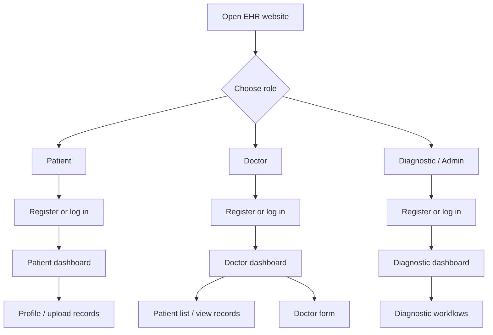
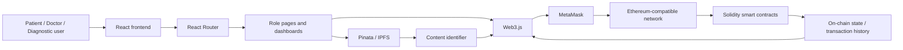
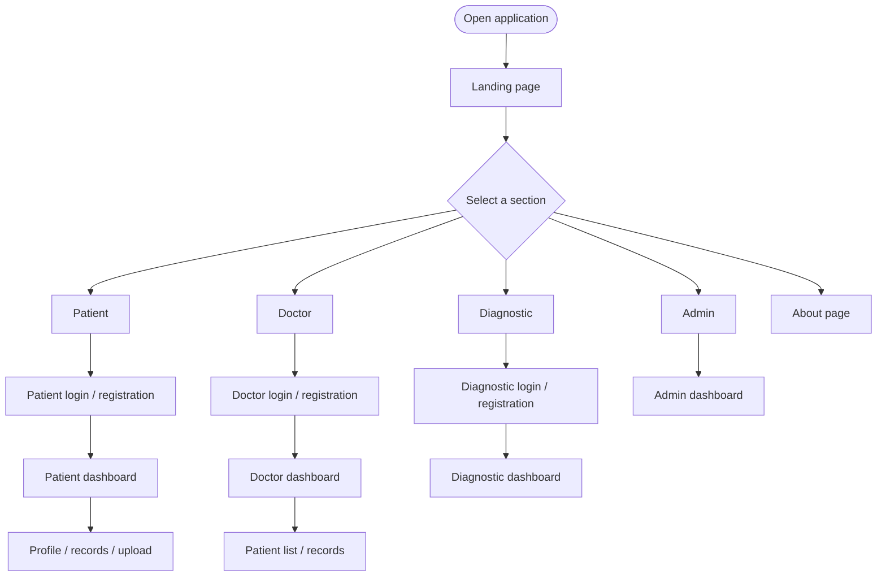
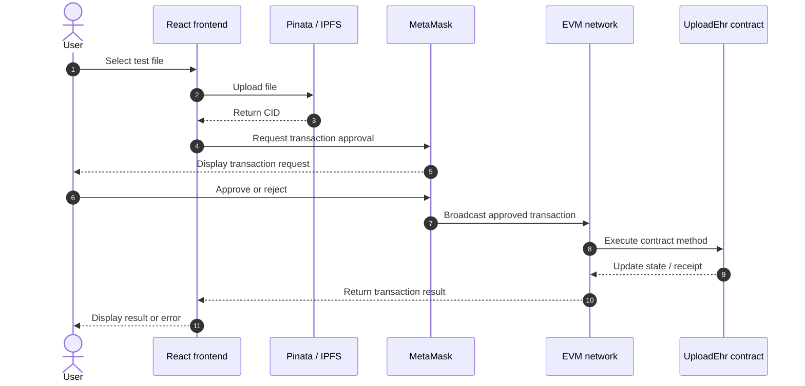
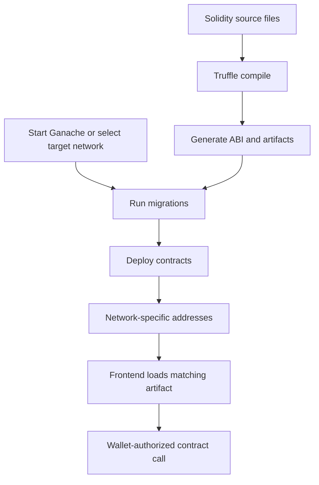

# SEHR — Secure Electronic Health Records on Blockchain

<p align="center">
  <strong>A decentralized Electronic Health Record (EHR) demo built with React, Solidity smart contracts, MetaMask, Web3.js, and IPFS/Pinata.</strong>
</p>

<p align="center">
  <a href="https://thezohaibkhan.github.io/EHR/">🌐 GitHub Pages Deployment</a> ·
  <a href="https://github.com/TheZohaibKhan/EHR">📦 Source Code</a> ·
  <a href="docs/DEPLOYMENT_DIAGRAM.md">Architecture Diagram</a> ·
  <a href="docs/SEQUENCE_DIAGRAM.md">Upload Sequence</a>
</p>

> **Deployment status:** The GitHub Pages URL is configured and serves the frontend, but the full user interface and blockchain workflows still need to be verified. A page loading successfully does not mean that smart contracts, MetaMask, or IPFS uploads are fully configured.

---

## Table of Contents

- [1. Project Overview](#1-project-overview)
- [2. Problem Statement](#2-problem-statement)
- [3. Objectives](#3-objectives)
- [4. Features and Modules](#4-features-and-modules)
- [5. User Roles](#5-user-roles)
- [6. Technology Stack](#6-technology-stack)
- [7. System Architecture](#7-system-architecture)
- [8. Application Flow](#8-application-flow)
- [9. Medical Record Upload Flow](#9-medical-record-upload-flow)
- [10. Smart Contracts](#10-smart-contracts)
- [11. Repository Structure](#11-repository-structure)
- [12. Prerequisites](#12-prerequisites)
- [13. Local Installation](#13-local-installation)
- [14. Configure Ganache and MetaMask](#14-configure-ganache-and-metamask)
- [15. Compile and Deploy Contracts](#15-compile-and-deploy-contracts)
- [16. Run and Build the React App](#16-run-and-build-the-react-app)
- [17. GitHub Pages Deployment](#17-github-pages-deployment)
- [18. Environment Variables and Secrets](#18-environment-variables-and-secrets)
- [19. Testing Checklist](#19-testing-checklist)
- [20. Troubleshooting](#20-troubleshooting)
- [21. Security and Privacy](#21-security-and-privacy)
- [22. Limitations](#22-limitations)
- [23. Future Enhancements](#23-future-enhancements)
- [24. Contributing](#24-contributing)
- [25. License](#25-license)
- [26. References](#26-references)

---

## 1. Project Overview

SEHR (Secure Electronic Health Records) is an academic/demo application exploring how a web interface, an Ethereum-compatible blockchain, and off-chain file storage can work together for electronic health-record workflows.

The frontend is built with React. React Router handles navigation between patient, doctor, diagnostic, and administrative pages. Web3.js connects the browser to an injected wallet provider such as MetaMask. Solidity smart contracts handle supported registration and record-reference operations. The record-upload design uses IPFS/Pinata for off-chain files and a content identifier (CID/hash) as a reference.

Large medical files should not be stored directly on a public blockchain. A blockchain reference also does not make a file private: access control and encryption must be designed separately.

### Live deployment

**[Open the EHR GitHub Pages site](https://thezohaibkhan.github.io/EHR/)**

The URL is the project's frontend deployment. The current deployment should be treated as a demo until the landing page, deep links, wallet connection, contract network, and IPFS upload flow have all been tested.

---

## 2. Problem Statement

Electronic health records can be spread across disconnected systems, making it difficult to keep records organized and traceable. A conventional centralized application also depends on the operator's infrastructure and access-control practices.

This project demonstrates a decentralized approach in which:

- React provides the user interface.
- MetaMask can authorize wallet-based actions.
- Solidity contracts process supported registration and record-reference operations.
- IPFS/Pinata can store files off-chain.
- A CID and blockchain transaction receipt can provide references for troubleshooting and traceability.

This is a learning project, not a certified healthcare system. Do not use it for real patient data without appropriate security, privacy, clinical, and regulatory review.

## 3. Objectives

1. Provide role-based UI flows for patients, doctors, and diagnostic/administrative users.
2. Demonstrate wallet connection and transaction signing.
3. Use Solidity smart contracts for supported registration and EHR reference operations.
4. Keep file bytes off-chain and use IPFS content identifiers where implemented.
5. Provide profile, dashboard, record-upload, and record-viewing pages.
6. Document development, contract deployment, frontend hosting, and troubleshooting.
7. Establish a foundation for future security, testing, and accessibility improvements.

---

## 4. Features and Modules

The repository contains UI components and routes for the following modules. The presence of a component does not by itself guarantee that the complete feature works; deployed contracts and service configuration may still be required.

| Module | Purpose / relevant source |
|---|---|
| Landing page | `src/components/LandingPage_1.js` |
| Animated background | `src/components/Background3D.js` |
| Patient registration and login | Patient registration/login components |
| Doctor registration and login | Doctor registration/login components |
| Diagnostic registration and login | Diagnostic registration/login components |
| Patient dashboard | `src/components/PatientDashBoard.js` |
| Doctor dashboard | `src/components/DoctorDashBoard.js` |
| Diagnostic dashboard | `src/components/DiagnosticDashBoard.js` |
| Admin dashboard | `src/components/AdminDashboard.js` |
| Patient record upload | `src/components/PatientUpload.js` |
| Record viewing | `src/components/ViewPatientRecords.js` and related components |
| Profile pages | Patient, doctor, and diagnostic profile components |
| Wallet interaction | Web3.js and MetaMask integration |
| File upload helper | `src/utils/pinataClient.js` |
| Smart contracts | Solidity files under `contracts/` and/or `src/contracts/` |
| Client-side navigation | `src/BrowseRouter.js` |
| Deployment workflow | `.github/workflows/deploy.yml` |

---

## 5. User Roles

### Patient

The patient flow includes registration/login, a patient dashboard, profile-related navigation, and a medical-record upload route. The upload component is designed to accept a file or an existing IPFS hash/CID.

### Doctor

The doctor flow includes registration/login, a dashboard, patient-list/profile navigation, record viewing, and a doctor-form route for consultation or prescription-related workflows.

### Diagnostic / Admin

The project includes diagnostic registration/login, a diagnostic dashboard, and an admin dashboard. The exact permissions and access restrictions must be confirmed against the React code and Solidity contracts.

### Role flowchart



---

## 6. Technology Stack

| Technology | Role |
|---|---|
| React | Frontend UI |
| Create React App / `react-scripts` | Development server and production build |
| React Router DOM | Client-side navigation |
| JavaScript, HTML, CSS | Application logic and styling |
| Web3.js | Blockchain provider and contract interaction |
| MetaMask | Wallet connection and transaction approval |
| Solidity | Smart-contract language |
| Truffle | Contract compilation and migration |
| Ganache | Local development blockchain |
| IPFS / Pinata | Off-chain file storage and content identifiers |
| Three.js / React Three Fiber | Animated 3D background |
| Leaflet | Map UI dependencies where used |
| Font Awesome | Icons |
| GitHub Actions | Automated frontend build and deployment |
| GitHub Pages | Static frontend hosting |

Use `package.json`, `package-lock.json`, and the relevant Truffle configuration as the source of truth for installed versions and paths.

---

## 7. System Architecture

The project has four main layers:

1. **Presentation:** React pages, dashboards, forms, and navigation.
2. **Wallet / interaction:** Web3.js communicates with the browser wallet provider; MetaMask asks the user to approve wallet access and transactions.
3. **File storage:** IPFS/Pinata stores uploaded file bytes off-chain and returns a CID.
4. **Blockchain:** Solidity contracts process supported operations and maintain on-chain state.

### High-level architecture



### Architecture notes

- GitHub Pages hosts the static frontend only.
- It does not run Ganache, deploy contracts, or securely hold private API credentials.
- The wallet must connect to a network where the required contracts are deployed.
- Contract artifacts must contain deployment information for the active network.
- An IPFS CID is a content reference, not an access-control mechanism.

---

## 8. Application Flow

The route definitions are in `src/BrowseRouter.js`. The root route `/` is intended to render `LandingPage_1`.



---

## 9. Medical Record Upload Flow

The intended upload flow is:

1. The user selects a test file or enters an existing CID.
2. The browser checks for a wallet provider when a blockchain operation is required.
3. The frontend uploads the file to the configured Pinata/IPFS service.
4. The service returns a CID/content identifier.
5. The frontend loads the appropriate `UploadEhr` contract artifact and network deployment.
6. The application requests the relevant contract transaction.
7. MetaMask asks the user to approve or reject the transaction.
8. The UI should report success or show an error.



**Note:** The precise method signatures, validation, and permission rules must be verified in the actual contract and component source. Use non-sensitive sample files only.

---

## 10. Smart Contracts

The project includes the following Solidity contract files:

| Contract | Intended responsibility |
|---|---|
| `PatientRegistration.sol` | Patient registration-related operations |
| `DoctorRegistration.sol` | Doctor registration-related operations |
| `DiagnosticRegistration.sol` | Diagnostic registration-related operations |
| `UploadEhr.sol` | EHR record-reference upload/retrieval operations |

### Contract lifecycle



The repository contains Truffle-related files and contract sources in more than one location. Before compiling or migrating, confirm which `truffle-config.js` is intended and that its contract, migration, and artifact output paths match the repository. The deployment workflow currently expects artifacts under `src/build/contracts/`.

---

## 11. Repository Structure

The following is a representative structure based on the repository:

```text
EHR/
├── .github/
│   └── workflows/
│       └── deploy.yml
├── public/
│   ├── index.html
│   ├── favicon.ico
│   └── manifest.json
├── src/
│   ├── App.js
│   ├── BrowseRouter.js
│   ├── App.css
│   ├── components/
│   │   ├── LandingPage_1.js
│   │   ├── Background3D.js
│   │   ├── PatientDashBoard.js
│   │   ├── DoctorDashBoard.js
│   │   ├── DiagnosticDashBoard.js
│   │   ├── AdminDashboard.js
│   │   ├── PatientUpload.js
│   │   └── ...other role, form, login, and profile components
│   ├── utils/
│   │   └── pinataClient.js
│   ├── contracts/
│   ├── migrations/
│   ├── test/
│   └── truffle-config.js
├── contracts/
│   ├── PatientRegistration.sol
│   ├── DoctorRegistration.sol
│   ├── DiagnosticRegistration.sol
│   └── UploadEhr.sol
├── docs/
│   ├── DEPLOYMENT_DIAGRAM.md
│   └── SEQUENCE_DIAGRAM.md
├── package.json
├── package-lock.json
└── README.md
```

This is a guide, not a guarantee that every optional file exists at the listed location. Check the current repository if paths have changed.

---

## 12. Prerequisites

Install the following tools for local development:

- Node.js and npm
- Git
- MetaMask browser extension
- Ganache for local blockchain testing
- Truffle through `npx`
- Pinata/IPFS configuration if testing file uploads

Verify Node.js and npm:

```bash
node --version
npm --version
```

---

## 13. Local Installation

### Step 1 — Clone the repository

```bash
git clone https://github.com/TheZohaibKhan/EHR.git
cd EHR
```

### Step 2 — Install frontend dependencies

Run from the directory containing the root `package.json`:

```bash
npm install
```

### Step 3 — Start a local blockchain

Open Ganache and start a local workspace. The documented development endpoint is `127.0.0.1:7545`, but use the actual RPC URL and chain ID shown by your workspace.

### Step 4 — Compile and migrate contracts

First inspect the intended Truffle configuration. In the repository's documented setup, contract commands are run from `src`:

```bash
cd src
npx truffle compile
npx truffle migrate --reset
cd ..
```

If Truffle cannot find the configuration, contract source, or migration files, confirm the working directory and paths in `truffle-config.js`. Do not run migrations against a network until you have confirmed which network is selected.

### Step 5 — Start React

From the project root:

```bash
npm start
```

Create React App normally serves the local application at:

```text
http://localhost:3000
```

### Step 6 — Smoke-test the app

- Open the landing page.
- Check patient, doctor, and diagnostic registration/login routes.
- Connect MetaMask only when needed.
- Test with dummy users and non-sensitive files.
- Check the browser console and terminal if anything fails.

---

## 14. Configure Ganache and MetaMask

1. Start Ganache and note its RPC URL and chain ID.
2. In MetaMask, add a local network using those exact values.
3. Use a development/test account only.
4. Open the React application and connect MetaMask.
5. Ensure the wallet is connected to the same network where the contracts were deployed.

Never commit a recovery phrase, private key, or funded wallet account. Never send wallet secrets to anyone.

### Network mismatch checklist

If the frontend reports that a contract is not deployed:

- Confirm Ganache or the target network is available.
- Confirm migrations completed successfully.
- Confirm MetaMask is on the correct network.
- Confirm the imported artifact has a deployment entry for that network ID.
- Confirm the frontend uses the artifact generated by the latest migration.

---

## 15. Compile and Deploy Contracts

Typical commands, from the directory containing the intended Truffle configuration:

```bash
npx truffle compile
npx truffle migrate --reset
```

- `truffle compile` compiles Solidity and generates contract artifacts.
- `truffle migrate --reset` reruns migration scripts and redeploys contracts to the selected network.
- Artifacts contain the ABI and, after deployment, network-specific addresses.

After redeployment, confirm that the frontend uses the updated artifacts. For public testnets or production networks, review fees, ownership, access control, and contract security before deploying.

---

## 16. Run and Build the React App

### Development server

```bash
npm start
```

### Production build

```bash
npm run build
```

Create React App normally outputs static frontend files to `build/`.

### Build notes

- The GitHub Actions workflow sets `PUBLIC_URL: /EHR` for the repository-based Pages URL.
- The workflow sets `CI: "false"` so existing ESLint warnings do not fail the CI production build. This is a deployment workaround, not a substitute for fixing the warnings.
- The workflow compiles Solidity contracts and checks for expected artifact files before building React.
- A successful React build does not deploy contracts or verify wallet/IPFS behavior.

---

## 17. GitHub Pages Deployment

The repository is configured to deploy through GitHub Actions.

### Live URL

**https://thezohaibkhan.github.io/EHR/**

### Workflow

The deployment workflow is located at:

```text
.github/workflows/deploy.yml
```

It is intended to:

1. Check out the repository.
2. Set up Node.js.
3. Install npm dependencies.
4. Compile Solidity contracts.
5. Verify the expected contract artifacts exist.
6. Build the React application with the `/EHR` public base path.
7. Upload the build output as a Pages artifact.
8. Publish the artifact to GitHub Pages.

### Deployment steps

1. Push changes to the `main` branch.
2. Open the repository's **Actions** tab.
3. Open the latest `Deploy React EHR to GitHub Pages` run.
4. Confirm both the `build` and `deploy` jobs succeed.
5. Open the live URL and hard-refresh using `Ctrl + F5`.

### React Router base path

Because this repository is hosted under `/EHR/`, React Router must use the correct base path for this deployment. The route setup in `src/BrowseRouter.js` should be checked for:

```jsx
<BrowserRouter basename="/EHR">
```

Do not add this base path blindly if you later deploy to a domain where the app is hosted at `/`; adjust the configuration to match the hosting environment.

### Deep-link refreshes

GitHub Pages is static hosting and does not provide a general React Router server fallback by default. A route may work when navigated to inside the app but return 404 when opened or refreshed directly. Test the home page and nested routes separately, and use a compatible SPA fallback strategy if direct deep links are required.

### Important: frontend versus blockchain

GitHub Pages only hosts the React frontend. It does not run Ganache, deploy smart contracts, or protect privileged Pinata credentials. For other users to perform blockchain actions, the contracts must be deployed to an accessible network and the frontend must use the matching network configuration and artifacts.

---

## 18. Environment Variables and Secrets

The file-upload helper is located at:

```text
src/utils/pinataClient.js
```

Inspect that file to determine how it currently handles Pinata credentials.

### Security requirements

- Never commit Pinata JWTs, API secrets, private keys, seed phrases, or deployment mnemonics.
- A React environment variable included in a frontend build is not secret; users can inspect the resulting JavaScript.
- Prefer a backend or serverless upload endpoint for privileged credentials.
- If a credential was committed, revoke or rotate it. Removing it in a later commit does not remove it from Git history.
- Keep local `.env` files out of version control.
- Use dummy data for demonstrations.

Only configure variable names that the implementation actually reads. Do not copy example credentials into the repository.

---

## 19. Testing Checklist

Before presenting the application as functional, test each layer independently.

- [ ] Landing page renders correctly at the deployed URL.
- [ ] Static assets and background animations load.
- [ ] Navigation buttons open the intended routes.
- [ ] Registration and login forms behave as expected.
- [ ] MetaMask missing and access-denied cases are handled.
- [ ] Wallet network matches the deployed contracts.
- [ ] Contract artifacts contain the correct network deployment.
- [ ] IPFS upload success and failure are handled.
- [ ] Blockchain transaction success and failure are displayed.
- [ ] Record views handle missing records and unavailable contracts.
- [ ] The production build completes.
- [ ] Nested routes are tested after refresh.
- [ ] No credentials or real patient information are committed.

Useful commands:

```bash
npm test
npm run build
```

Run Truffle tests from the directory containing the intended Truffle configuration:

```bash
npx truffle test
```

Tests may require a running local chain, compiled artifacts, and additional setup.

---

## 20. Troubleshooting

### `npm install` fails

- Run the command from the directory containing `package.json`.
- Check the first meaningful error in the terminal.
- Keep `package-lock.json` consistent with `package.json`.
- Confirm the installed Node.js version is compatible with the project.

### GitHub Actions reports ESLint warnings as errors

The current workflow sets `CI: "false"` for the React build to prevent existing lint warnings from blocking deployment. Review and fix unused variables, naming issues, invalid links, and hook-dependency warnings in the source code when possible.

### GitHub Pages returns 404

- Confirm the newest Actions run has succeeded for both `build` and `deploy`.
- Confirm Pages is configured to publish through GitHub Actions.
- Open the repository URL with the correct capitalization and base path: `/EHR/`.
- Verify the build artifact contains `index.html`.
- Check `PUBLIC_URL` and the React Router `basename`.
- Remember that nested routes can need an SPA fallback strategy.

### Only the footer or background appears

- Confirm `src/BrowseRouter.js` renders the intended landing component at `/`.
- Check the browser developer console for React errors.
- Inspect `LandingPage_1.js` and its CSS for layout, positioning, visibility, or runtime issues.
- Confirm that the deployed build contains the latest committed code.

### MetaMask is not detected

- Install and enable MetaMask.
- Refresh the page after enabling the extension.
- Confirm the browser supports the wallet extension.

### Contract is not deployed on the active network

- Check the network selected in MetaMask.
- Confirm migrations succeeded on that network.
- Check the generated artifact for the network ID and contract address.
- Rebuild and redeploy the frontend after updating artifacts.

### Pinata upload fails

- Review `src/utils/pinataClient.js`.
- Check service configuration, request errors, network access, and file-size restrictions.
- Do not paste secrets into public issues or commits.
- Move privileged API calls to a secure backend if credentials are currently exposed in the frontend.

---

## 21. Security and Privacy

Electronic health records are highly sensitive. Treat this as an academic/demo project unless it has undergone a full security, privacy, and compliance review.

1. **Do not put medical file contents on a public blockchain.** On-chain data is replicated and difficult to remove.
2. **A CID is not encryption.** A retrievable IPFS file may be accessible to anyone who obtains its CID unless a suitable encryption and access-control design is used.
3. **Protect API credentials.** Browser bundles and public repositories are visible to users.
4. **Use appropriate encryption and key management** for any sensitive file-storage design.
5. **Audit access controls.** Verify role checks, contract modifiers, ownership, and authorization logic in the actual source.
6. **Use test data only.** Do not upload real patient records to an unreviewed demo.
7. **Review applicable regulations** before any real-world healthcare deployment.
8. **Use test wallets** for development and demonstrations.

---

## 22. Limitations

- The app depends on browser wallet availability for wallet-based actions.
- Contract calls require deployed contracts and matching artifacts.
- Ganache is a local development blockchain, not a shared chain for public visitors.
- IPFS/Pinata functionality depends on valid service configuration.
- A CID does not itself enforce privacy or authorization.
- Static frontend hosting does not provide a backend or deploy smart contracts.
- GitHub Pages requires correct asset paths and special consideration for React Router deep links.
- The exact behavior and security of each feature must be verified against the component and Solidity implementation.
- The project is not production-ready healthcare infrastructure without substantial additional work.

---

## 23. Future Enhancements

- Add a secure backend/serverless API for privileged file uploads.
- Encrypt sensitive files before off-chain storage and define key access policies.
- Improve patient consent and revocable access-grant workflows.
- Add automated Solidity tests for authorization and edge cases.
- Centralize network and environment configuration.
- Improve loading, error, empty, and transaction-pending states.
- Add an audit-trail interface for record references and consent operations.
- Add accessibility, responsive-layout, and browser tests.
- Add dependency scanning, secret scanning, and smart-contract security analysis.
- Fix existing ESLint warnings instead of relying on CI warning suppression.
- Separate frontend hosting, contract deployment, and storage-service configuration in deployment documentation.

---

## 24. Contributing

Contributions to documentation, testing, accessibility, and the demo are welcome.

1. Fork the repository.
2. Create a feature branch.
3. Make a focused change.
4. Run relevant tests and the production build.
5. Open a pull request describing the change and how it was tested.

Do not commit real patient data, private keys, wallet recovery phrases, or API credentials.

---

## 25. License

No explicit license has been confirmed in the supplied project details. Unless a license is added to the repository, do not assume that others have permission to reuse, redistribute, or modify this project. Add an appropriate `LICENSE` file if you intend to publish it as open source.

---

## 26. References

- [React](https://react.dev/)
- [Create React App](https://create-react-app.dev/)
- [React Router](https://reactrouter.com/)
- [Web3.js](https://web3js.readthedocs.io/)
- [MetaMask Developer Documentation](https://docs.metamask.io/)
- [Solidity Documentation](https://docs.soliditylang.org/)
- [Truffle Documentation](https://archive.trufflesuite.com/docs/)
- [IPFS Documentation](https://docs.ipfs.tech/)
- [Pinata Documentation](https://docs.pinata.cloud/)
- [GitHub Pages Documentation](https://docs.github.com/en/pages)
- [GitHub Actions Documentation](https://docs.github.com/en/actions)

---

<p align="center">
  <strong>SEHR — Secure. Transparent. Decentralized.</strong><br>
  <sub>Academic project documentation · Verify deployment and security settings before real-world use.</sub>
</p>
