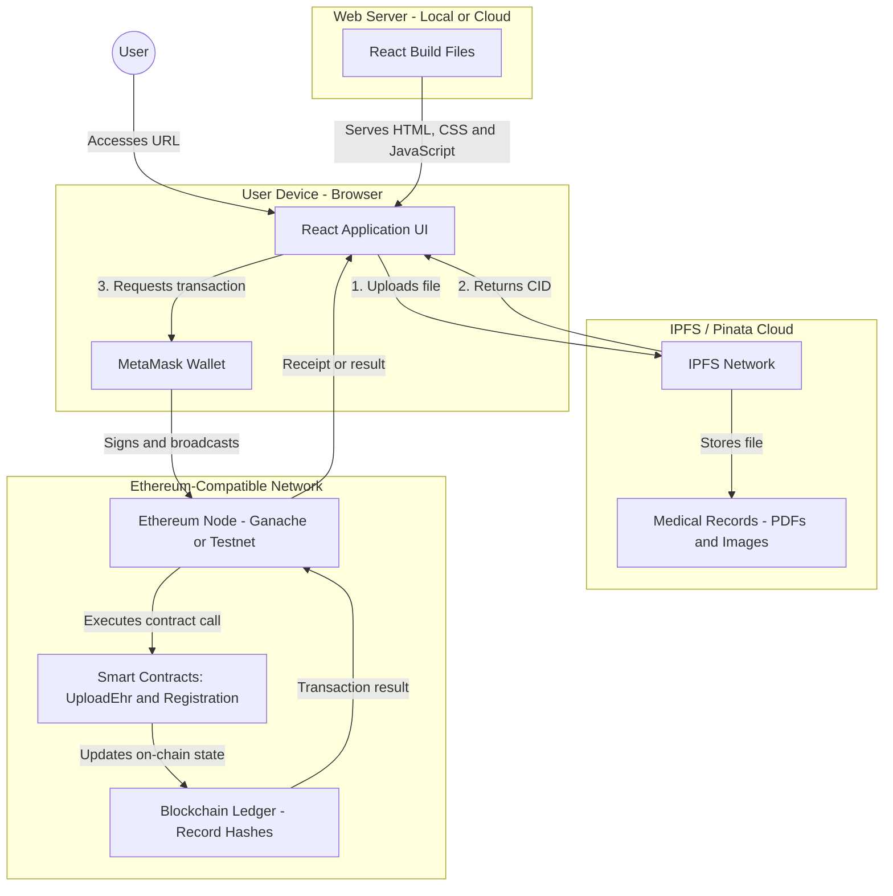

# Deployment Diagram: Decentralized EHR System

This diagram illustrates how the **Decentralized Electronic Health Record (EHR)** system is deployed and how its components interact.

## Explanation of Components

### 1. Client Device — User's Browser

- **React Application UI:** The frontend where patients, doctors, and other users interact with the application.
- **MetaMask Wallet:** A browser extension that manages the user's wallet and requests approval for blockchain transactions.

### 2. Web Server

- **Role:** Serves the static HTML, JavaScript, and CSS files required by the React application.
- **Development:** The app can run locally at `http://localhost:3000`.
- **Deployment:** GitHub Pages hosts the published frontend files. It does not run the blockchain node or deploy smart contracts.

### 3. IPFS / Pinata Cloud — Storage Layer

- **Role:** Stores files such as PDFs and medical images outside the blockchain.
- **Interaction:** The application uploads a file to the configured storage service and receives a content identifier (CID).
- **Important:** IPFS content is not automatically private or encrypted. A CID alone does not restrict access to a file.

### 4. Ethereum-Compatible Blockchain — Logic and Verification Layer

- **Role:** Executes deployed smart contracts and maintains on-chain state.
- **Smart contracts:** `PatientRegistration`, `DoctorRegistration`, `DiagnosticRegistration`, and `UploadEhr` are included in the project.
- **Ledger:** Records blockchain transactions and contract state. The exact information stored depends on the smart-contract implementation.

## Use Case: Uploading a Medical Record

1. The user selects a file in the React application.
2. The frontend uploads the file to the configured IPFS/Pinata service.
3. The service returns a content identifier (CID).
4. The frontend prepares a transaction referencing the CID.
5. MetaMask asks the user to approve or reject the transaction.
6. If approved, the transaction is sent to the configured blockchain network.
7. The deployed smart contract processes the request and updates its state if the transaction succeeds.
8. The application displays the transaction result.

**Security note:** This is an academic/demo project. Use sample files and test accounts only until the application has undergone appropriate security and privacy review.
