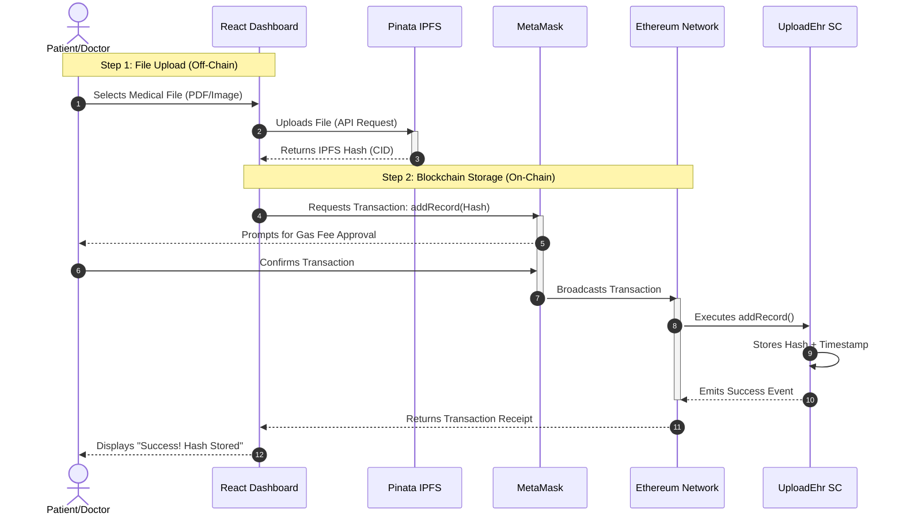

# Sequence Diagram: Uploading a Medical Record

This diagram details the exact step-by-step process when a user uploads a medical record to the decentralized EHR system.

## Detailed Flow

1.  **Selection**: The user selects a file (e.g., X-Ray) in the React Application.
2.  **IPFS Upload**: The app sends the file to **Pinata**. This is an off-chain action and does not incur gas fees.
3.  **Hash Generation**: Pinata stores the file and returns a unique **CID (Hash)**.
4.  **Transaction Request**: The app constructs a transaction to calling the smart contract `addRecord` function with this Hash.
5.  **Signing**: MetaMask pops up, asking the user to pay the **Gas Fee** for storing this small string.
6.  **Execution**: The transaction is mined on Ethereum. The Hash is permanently linked to the user's wallet address.
7.  **Confirmation**: The UI updates to show the successful link.
